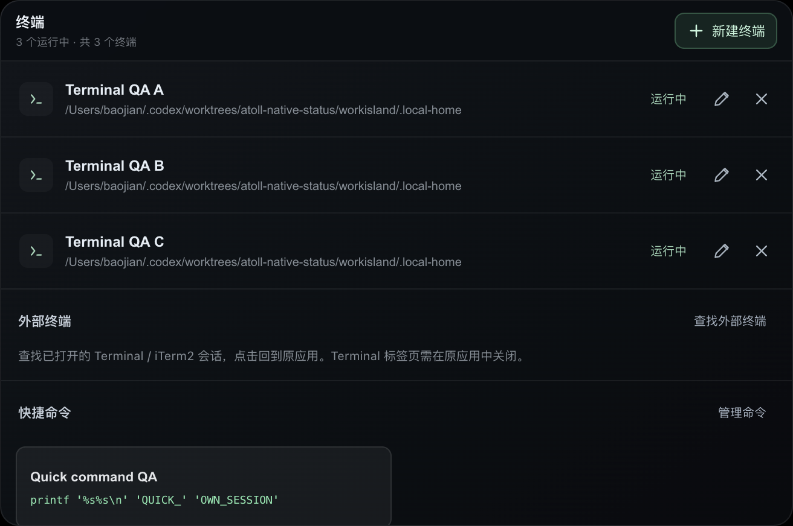

# 多终端管理验证记录

关联：[Issue #200](https://github.com/qianzhu18/workisland/issues/200)、[PR #201](https://github.com/qianzhu18/workisland/pull/201)、[PRD-013](../../product/prd/PRD-013-MULTI-TERMINAL-MANAGER.md)。

## 本地结果

- `npm run check`：719 / 719 tests，locale、source contracts 和构建检查通过。
- macOS arm64 本地 Developer ID 签名预览：`codesign --verify --deep --strict` 通过；实际包包含 Apple Events 用途说明和自动化 entitlement。没有提交公证或发布正式版本。
- 实际 `app.asar` 中的 12 个变更运行时文件逐字节匹配工作树；archive SHA-256：`ba97e760d97c9f79b23e9f27c42d9946e90c8bf7271b844515a8b343f64dde8e`。
- `FLUX_DEBUG_PORT=9353 node scripts/smoke-multi-terminal.mjs` 对最终签名包通过。操作真实 xterm / node-pty：创建三个独立 Shell，分别执行命令；后台输出、半行输入、环境变量互不污染；滚轮移动后的历史位置、持久 DOM 和 alternate screen 跨切换保留；关闭中间终端后其测试子进程退出，另两项可继续输入；键盘重命名、独立快捷命令、退出码 7 与原条目重启、插件切换、失焦收起和重新进入、禁用停止全部通过。
- 多条目布局：8 项列表自身滚动（503px 内容 / 270px 高度）；654px 宽时 scrollWidth 为 654px，窄组件 378px 时 scrollWidth 为 378px；80 字符名称、长目录、窄终端标题没有横向溢出。窄组件通过临时宽度约束验证，未冒充独立窄屏设备测试。
- 检查实际截图，沿用产品深色外观、现有工具入口，无新增工具栏槽位。Impeccable detector 没有指出本次新增阻断项，唯一 motion advisory 为原有样式。

## 外部宿主验证

最终签名包主动扫描了运行中的系统 Terminal，按名称与 tty 找到测试专用窗口，focus 返回成功。此前签名候选包同一控制路径验证时，系统前台应用确认为 `com.apple.Terminal`。Terminal 条目的关闭能力为 false，调用关闭返回 `close-in-host`，不会关闭整个窗口。用户已有会话未被输入命令或关闭。

iTerm2 本机未安装。官方字典与 API 已核对，注入测试覆盖唯一会话定位、过期目标拒绝、关闭确认等待、权限拒绝和关闭后枚举失败；**尚未完成 iTerm2 真机 focus / close**。系统拒绝授权的分支由注入 runner 验证，没有通过脚本改动用户隐私授权。

## 审查与清理

独立审查发现一项关闭结果验证问题：操作后宿主读取失败会被误认为目标消失。先增加失败回归，再检查 per-host error 后返回失败；修复后 external / stream 9 项通过。

所有自动化交互使用隔离数据目录，仅清理脚本自身创建的终端并恢复隔离设置。保留已安装正式版和已有终端；不会将测试包当作正式更新。远程 CI 状态以 PR checks 为准。
