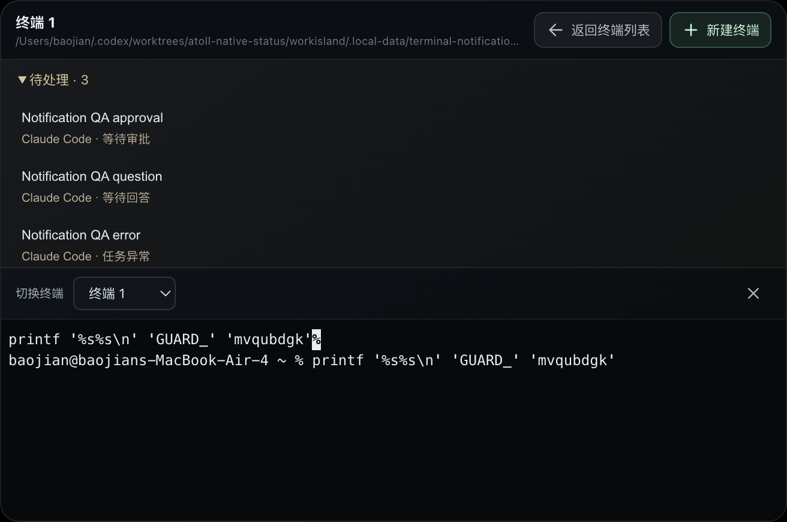

# 终端提醒避让验证

关联：[用户确认的设计](../specs/2026-10-27-terminal-notification-guard-design.md)、[PR #201](https://github.com/qianzhu18/workisland/pull/201)。

## 复现与修正

旧签名预览实际复现：自动通知开始倒计时后进入终端列表，在没有输入焦点的阅读状态停留超过五秒，列表仍被收起。旧路径只保护聚焦的输入控件，没有保护整个终端页；通知也没有按当前页面避让。

修正接收 Agent 自动 surface、旧 surface 生命周期和自动收起计时器三处。使用已提交 DOM 的可见标记，避免异步闭包使用过期页面状态。Agent session 更新继续处理，待处理项从最新会话状态推导，不建立积压通知重播队列。

## 实测结果

- `npm run check`：723 / 723 tests，renderer 构建、source contracts、locale 检查通过。
- `scripts/smoke-terminal-notifications.mjs`：旧签名包失败于「已启动的倒计时不能收起终端列表」断言；修正后源码预览和最终 Developer ID 签名包全部通过。
- 真实 PTY / xterm 保留半行命令，连续收到模拟的提交、普通完成、审批、提问、异常状态和自动 surface 后，当前终端 ID、输入焦点和 DOM 实例不变。点击待处理审批才进入对应 Agent 卡片；返回后继续提交原命令，实际 Shell 输出匹配测试标识。
- 三个待处理项可展开并选择；状态转回 running 或会话移除后不残留。阅读终端列表时即使没有输入焦点也不会自动收起。其他工具仍正常自动收起，已经收起的灵动岛仍接收正常提醒。
- 验证通过真实 main → renderer IPC 传递模拟 Agent 生命周期，不冒充真实第三方 hook 或帐号端到端验证。
- 实际包内八个变更运行时文件与工作树逐字节匹配；`codesign --verify --deep --strict` 通过。app.asar SHA-256：`38c963d8073ae851ade9facadd5f8e70454d8f61181372fa6430740e3c6923a5`。

本轮使用独立用户目录与测试 HOME；未替换 `/Applications/WorkIsland.app`，未触碰已有终端，未更改用户的提醒设置、系统授权或公开发布版本。远程 CI 以 PR 最新提交的 checks 为准。
